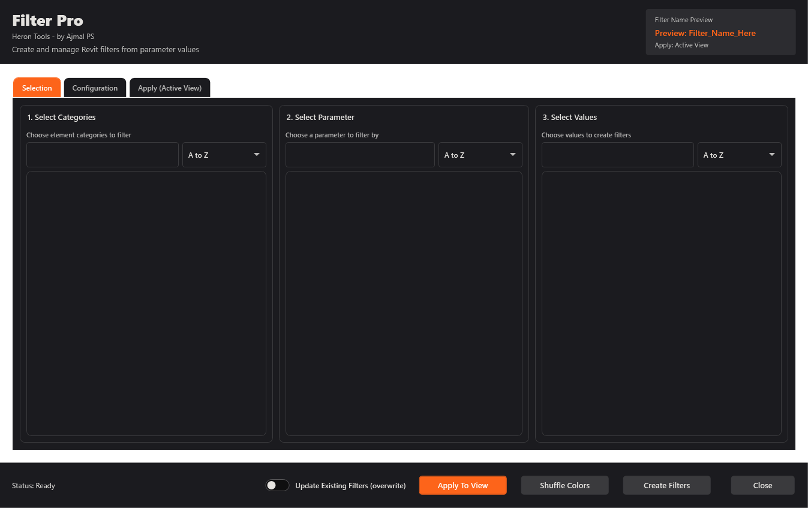

<p align="center">
  <picture>
    <source media="(prefers-color-scheme: dark)" srcset="docs/brand/heron-mark-white.svg">
    
  </picture>
</p>

<h1 align="center">Heron Tools</h1>

<p align="center">Everyday Revit tools for BIM modellers, on the <b>Heron</b> ribbon tab.</p>

<p align="center">
  
  
  <a href="https://github.com/Ajmalpshaik/Heron-Tools/actions/workflows/build.yml"></a>
</p>

Heron Tools is a stand-alone Revit add-in. It does not need Heron AI and uses none of Heron AI's code.
The two only share the name of the ribbon tab, so when both are installed their buttons sit side by
side on one **Heron** tab.

| Tool | Panel | What it does |
|---|---|---|
| **Filter Pro** | View | Pick categories, a parameter and its values. Filter Pro makes one view filter per value, names it for you (the name says the rule, e.g. "Not 300", "Has value") and adds it to the active view or views you pick, first in the filter list. Shuffle colours gives every filter its own colour. |
| **Colorize** | View | The same picks, but the colour goes straight onto the matching elements (no view filter) - by value, or whole categories. **Restore original** puts back the elements' own overrides. |
| **View Crop** | View | **Crop View by Elements** fits plan crops around their elements with a margin. **Annotation Crop by View Crop** turns the annotation crop on at an offset measured on paper. |
| **Unhide All** | View | Shows everything hidden one by one in the view and turns Temporary Hide/Isolate off. |
| **Toggle Links** | View | Turns the RVT Links category off or on in the view, and says if some links stay hidden one by one. |
| **Highlight** | View | Selection in red, the rest grey. **Click again to put the view back** - every element's own overrides are remembered. |

Every button press is **one Undo step**; if anything fails, the whole run is undone and the window says so.

**The Filter Pro window** reads left to right in the order you work: **1 Categories - 2 Parameter - 3 Values**,
each with a count ("2 of 10 picked"), a search box and an empty-list hint. On the right, the live **name
preview** sits above four tabs - **Rule** (rules that do not suit the picked parameter are switched off),
**Name**, **Apply** (active view or picked views) and **Colours**. Anything a run skipped is listed with the
reason; a missing pick is said in the status line, never in a pop-up. Only **Apply to view** is orange.



## Supported Revit versions

| Revit | .NET runtime it is built for | Built | Installed by `build.ps1` when that Revit is on the PC |
|---|---|---|---|
| 2020 | .NET Framework 4.7.2 (`net472`) | yes | yes |
| 2021 | .NET Framework 4.8 (`net48`) | yes | yes |
| 2022 | .NET Framework 4.8 (`net48`) | yes | yes |
| 2023 | .NET Framework 4.8 (`net48`) | yes | yes |
| 2024 | .NET Framework 4.8 (`net48`) | yes | yes |
| 2025 | .NET 8 (`net8.0-windows`) | yes | yes |
| 2026 | .NET 8 (`net8.0-windows`) | yes | yes |
| 2027 | .NET 10 (`net10.0-windows`) | yes | yes |
| 2028 and later | not known yet | no | no |

Autodesk changed the runtime at 2025 and again at 2027, so a new Revit release is never assumed. When
Revit 2028 ships: confirm its .NET target in the Autodesk SDK, then add it in three places -
`Directory.Build.props` (one row), `manifests/` (a new `HeronTools.2028.addin` with its own new
AddInId), and the year list in `build/build.ps1`. The build stops with a clear message for any year
it does not know.

## Build and install

You need the **.NET 10 SDK** (it builds every target, including the old .NET Framework ones). Revit's
own DLLs are not needed and are never committed: the project references Autodesk's API through the
`Nice3point.Revit.Api` NuGet packages, set so they are never copied into the build.

Close Revit, then from the repository folder:

```powershell
powershell -ExecutionPolicy Bypass -File build\build.ps1
```

The script builds every Revit year, then, for each Revit installed on the PC, copies:

```
%AppData%\Autodesk\Revit\Addins\<year>\HeronTools.addin
%AppData%\Autodesk\Revit\Addins\<year>\HeronTools\HeronTools.dll
```

It skips any year whose Revit is not installed, or is open, and prints a summary table.
Useful options: `-Years 2024,2026` builds only those years, and `-NoInstall` builds without copying.

To build one year by hand:

```powershell
dotnet build src\HeronTools\HeronTools.csproj -c Release -p:RevitVersion=2024
```

The install is per user (no admin rights). That is deliberate: Revit 2027 moved the **all-users**
add-in folder from `C:\ProgramData` to `C:\Program Files` (admin only); the per-user folder is the
same on every release.

## Uninstall

```powershell
powershell -ExecutionPolicy Bypass -File build\uninstall.ps1
```

It removes only `HeronTools.addin` and the `HeronTools` folder from each Revit year. Heron AI and every
other add-in are left alone. Add `-DryRun` to see what it would remove.

## How it shares the Heron tab

Revit decides which add-in loads first and never says. So Heron Tools never assumes it is first:

```csharp
try { app.CreateRibbonTab("Heron"); }
catch (Autodesk.Revit.Exceptions.ArgumentException) { /* tab exists */ }
var panel = app.CreateRibbonPanel("Heron", "View");
```

- **Installed alone:** the tab does not exist, so Heron Tools creates it and adds its **View** panel.
- **Installed with Heron AI:** whichever loads first creates the tab; the other's `CreateRibbonTab`
  throws "already exists", which is caught, and its panel joins the same tab. One tab, two panels.

Only that one exception is caught, by its full name. The tab name `Heron` must keep this exact
spelling and case - one letter different makes a second tab.

What keeps the two products apart: assembly `HeronTools.dll` (Heron AI has none by that name), its own
AddInId GUID per Revit year, namespace `HeronTools`, install folder `HeronTools`, and panel name
`View` (Heron AI uses other panel names).

## Rules this code follows

- **Same file standard as the Heron AI platform.** Every source file starts with the five Heron metadata
  fields (`Heron-Agent`, `Heron-Step`, `Heron-Status`, `Heron-Since`, `Heron-Layer`) - see
  [docs/metadata-standard.md](docs/metadata-standard.md). `build/check-metadata.ps1` checks them, and
  `build.ps1` will not build while a file is missing them.
- **Gates on every push** (GitHub Actions, `Gates`): the metadata check, then a compile against every
  Revit release 2020-2027. A compile is not a Revit test.

- Every button that changes the model runs as **one named transaction** - one Undo entry, named
  `Filter Pro: ...`. If anything in that run fails, the whole run is rolled back and the modeller is
  told, in plain words, that nothing was changed.
- Revit's API is called only from Revit's own thread. Filter Pro's window is modal, so it runs there;
  any future modeless window must reach the API only through an `ExternalEvent`.
- Version-specific API code lives only in `src/HeronTools/Helpers/` behind `REVIT<year>` /
  `REVIT<year>_OR_GREATER` compile symbols (units 2021, parameter types 2022, case-sensitive filter
  rules 2023, 64-bit `ElementId.Value` 2024, `IntegerValue` removed 2026).
- Window colours and font come only from the Heron brand palette - see the header of
  `src/HeronTools/UI/HeronStyles.xaml`. (Colours a tool writes into the *model*, such as filter
  colours, are model colours and not part of the brand.)
- The logo is the Heron mark from the designer's brand kit - the same artwork Heron AI uses -
  kept in `docs/brand/` (mark in ink and white, app icon in ink and orange). Every window shows the
  mark in its header and the orange app icon on its title bar. The full "Heron AI" wordmark is not
  used here, because it names the other product.

## Repository layout

```
src/HeronTools/          the add-in (one project, every Revit year)
  App/                   start-up class: builds the ribbon
  Commands/              ribbon commands
  Services/              each tool's Revit work (FilterPro, Colorize, ViewCrop, UnhideAll, GraphicsTools)
  Models/  Helpers/      data classes; version-safe helpers
  UI/                    windows and the brand theme (HeronStyles.xaml)
  Resources/Icons/       16 and 32 px ribbon icons
manifests/               one .addin manifest per Revit year
build/                   build.ps1, uninstall.ps1, check-metadata.ps1
docs/                    notes (what was moved and fixed, metadata standard, ideas for Heron AI), pictures
Directory.Build.props    Revit year -> .NET runtime, output folders, compile symbols
```

## Project documents

[CONTRIBUTING](CONTRIBUTING.md) · [SECURITY](SECURITY.md) · [CODE OF CONDUCT](CODE_OF_CONDUCT.md) ·
[DISCLAIMER](DISCLAIMER.md) · [CHANGELOG](CHANGELOG.md) · [AGENTS](AGENTS.md) (for AI agents working on the code)

Records: [Filter Pro move notes](docs/filter-pro-move-notes.md) · [View tools move notes](docs/view-tools-move-notes.md) ·
[Metadata standard](docs/metadata-standard.md) · [Ideas for Heron AI](docs/ideas-for-heron-ai.md)

## Licence

Copyright (c) 2026 Ajmal PS. All rights reserved.
