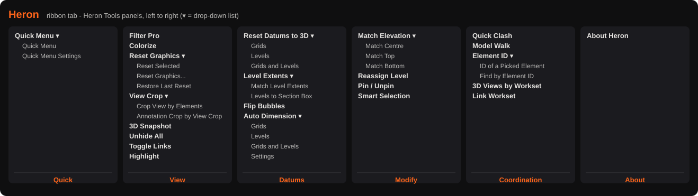
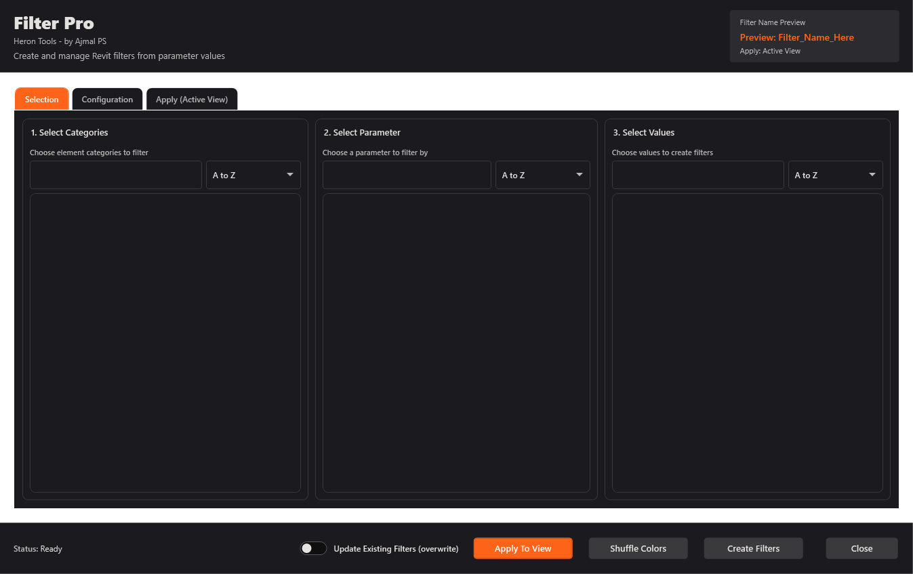
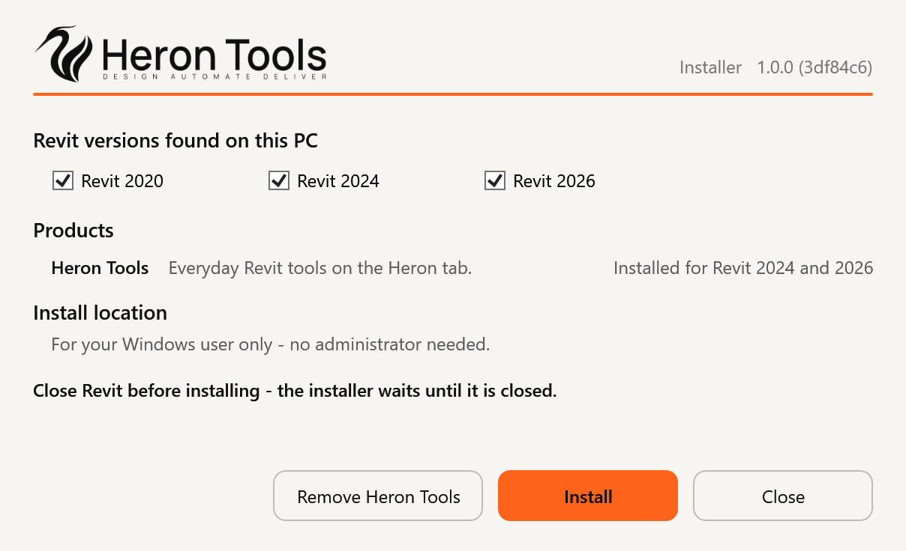

<!-- One banner picture that reads on GitHub's light AND dark theme (a <picture> switching on
     prefers-color-scheme follows the computer, not GitHub, and can show a white logo on a white page).
     Made by build/make-readme-banner.ps1, the same recipe as Heron AI's banner. -->
<p align="center">
  
</p>

<p align="center">
  <a href="LICENSE"></a>
  <a href="https://github.com/Ajmalpshaik/Heron-Tools/actions/workflows/build.yml"></a>
  <a href="#supported-revit-versions"></a>
  <a href="#tools"></a>
</p>

<p align="center">
  <a href="#tools">Tools</a> ·
  <a href="#supported-revit-versions">Revit versions</a> ·
  <a href="docs/install.md">Install</a> ·
  <a href="#help">Help</a> ·
  <a href="#rules-this-code-follows">Safety</a> ·
  <a href="#project-documents">Docs</a> ·
  <a href="CONTRIBUTING.md">Contributing</a>
</p>

# Heron Tools

**Everyday Revit tools for BIM modellers, on the Heron ribbon tab.**
View filters and colours in a few clicks, tidy crops and datums, MEP elevations and levels, a clash check and a
model walk - for Revit 2020 to 2027, free and open source.

**Who it is for:** BIM modellers and coordinators (MEP first) who repeat the same view, datum and coordination
jobs every day and want them done in one click, with one Undo step and a way back.

> **Status:** in development. Every tool builds for Revit 2020 to 2027, but none has been signed off in a real
> Revit model yet. Try it on a copy of a model first.

## Tools

Heron Tools is a stand-alone Revit add-in. It does not need Heron AI and uses none of Heron AI's code. The two
only share the name of the ribbon tab, so when both are installed their buttons sit side by side on one
**Heron** tab.



Every tool, step by step, with what it changes and how to undo it: **[tool catalogue](docs/tools/README.md)**.

| Panel | Tool | What it does |
|---|---|---|
| [Quick](docs/tools/quick.md) | **Quick Menu** | A tool wheel at the mouse pointer with your favourite Heron Tools buttons and Revit commands; **Quick Menu Settings** chooses what sits in each slot. |
| [View](docs/tools/view.md) | **Filter Pro** | One view filter per parameter value, named for you, added to the view first in the list; **Shuffle colours** gives each its own colour. |
| | **Colorize** | The same picks, but the colour goes straight onto the elements (no filter). **Restore original** puts their own overrides back. |
| | **Reset Graphics** | Clear the overrides of the selection, or of whole views and categories - it counts first. **Restore Last Reset** puts them back. |
| | **View Crop** | Fit plan crops around their elements with a margin; set the annotation crop at an offset on paper. |
| | **3D Snapshot** | Fit Revit's own {3D} view to a selected room, a section, or a window you drag in a plan - you stay in your view. |
| | **Unhide All** | Show everything hidden one by one in the view and turn Temporary Hide/Isolate off. |
| | **Toggle Links** | Turn the RVT Links category off or on in the view. |
| | **Highlight** | Selection in red, the rest grey. **Click again to put the view back.** |
| [Datums](docs/tools/datums.md) | **Reset Datums to 3D** | Put grid and/or level ends in the view back to their 3D extents. |
| | **Level Extents** | Match level extents to another level, or stretch them to the section box. |
| | **Flip Bubbles** | Swap which end of a grid or level shows its bubble. |
| [Modify](docs/tools/modify.md) | **Match Elevation** | Match the centre, top or bottom elevation of a source MEP element. |
| | **Reassign Level** | Move MEP elements to another reference level without moving them in space. |
| | **Pin / Unpin** | Pin or unpin groups: title blocks, views on sheets, ducts, pipes, grids, levels... |
| | **Smart Selection** | Pick one element, window-select, keep only that category. |
| [Coordination](docs/tools/coordination.md) | **Quick Clash** | A Navisworks-style clash test in the active 3D view, in a window that stays open. **Reset view** puts every element's own colours back (also done before Save and Sync). |
| | **Model Walk** | Walk the model in first or third person from a 3D view; inspect, select, measure and record snags with a picture. [Guide](docs/model-walk-guide.md). |
| | **Element ID** | See the ID of a picked element (also in links), or find an element by ID and zoom to it. |
| | **3D Views by Workset** | One 3D view per user workset. |
| | **Link Workset** | Put Revit links and CAD imports on a workset. |
| [About](docs/tools/about.md) | **About Heron** | Version details and the Heron family. |

Every button press is **one Undo step**; if anything fails, the whole run is undone and the window says so.

**The Filter Pro window** reads left to right in the order you work: **1 Categories - 2 Parameter - 3 Values**,
each with a count ("2 of 10 picked"), a search box and an empty-list hint. On the right, the live **name
preview** sits above four tabs - **Rule**, **Name**, **Apply** (active view or picked views) and **Colours**.
Anything a run skipped is listed with the reason. Only **Apply to view** is orange.



## Supported Revit versions

| Revit | .NET runtime it is built for | Built | Installed by the installer / `build.ps1` when that Revit is on the PC |
|---|---|---|---|
| 2020 | .NET Framework 4.7.2 (`net472`) | yes | yes |
| 2021 | .NET Framework 4.8 (`net48`) | yes | yes |
| 2022 | .NET Framework 4.8 (`net48`) | yes | yes |
| 2023 | .NET Framework 4.8 (`net48`) | yes | yes |
| 2024 | .NET Framework 4.8 (`net48`) | yes | yes |
| 2025 | .NET 8 (`net8.0-windows`) | yes | yes |
| 2026 | .NET 8 (`net8.0-windows`) | yes | yes |
| 2027 | .NET 10 (`net10.0-windows`) | yes | yes |
| 2028 and later | not known yet | no | no |

Autodesk changed the runtime at 2025 and again at 2027, so a new Revit release is never assumed. When
Revit 2028 ships: confirm its .NET target in the Autodesk SDK, then add it in three places -
`Directory.Build.props` (one row), `manifests/` (a new `HeronTools.2028.addin` with its own new
AddInId), and the year list in `build/build.ps1`. The build stops with a clear message for any year
it does not know.

## Install (for modellers)

Full guide - update, remove, where the files go, common problems: **[docs/install.md](docs/install.md)**.

1. Download **`HeronToolsInstaller.exe`** from the newest release on the [Releases page](https://github.com/Ajmalpshaik/Heron-Tools/releases)
   (the top one; a **Pre-release** badge means it is not yet tested in Revit).
2. Run it (Windows may say it is not signed: **More info > Run anyway**). No administrator rights needed.
3. Tick your Revit versions (2020 to 2027) and press **Install**. If that Revit is open, it waits until you close it.
4. Start Revit and look for the **Heron** tab. **About Heron** shows the version.

<p align="center">
  
</p>

- **Install** puts Heron Tools in the ticked versions (or replaces it - there is no separate Update or
  Repair). It never removes anything.
- **Remove Heron Tools** (shown only while it is installed - also when only a leftover `.addin` or
  `HeronTools` folder is there) takes it out of every Revit it is in. It asks
  first, with No already picked. To take it out of one version only: `/uninstall /years 2024` (below).
- If one of those Revit versions is open, it **waits** and says so, and carries on by itself once Revit is
  closed. It never closes Revit.
- It keeps the install it replaces (`%LocalAppData%\HeronTools\install-backup\<year>`), puts it back by
  itself if a copy fails (on a first install it takes out what it copied), and checks every file it writes against the build it carries.

For an office rolling it out to many PCs, the same file runs without a window:

```powershell
HeronToolsInstaller.exe /install                     # every Revit found on this PC
HeronToolsInstaller.exe /install /years 2024,2026    # only these
HeronToolsInstaller.exe /uninstall
HeronToolsInstaller.exe /status
```

Add `/log <file>` to keep what it did. Exit code 0 = done, 1 = something failed, 2 = nothing to do.

To make the installer yourself: `powershell -ExecutionPolicy Bypass -File build\build-installer.ps1` builds
Heron Tools for every Revit year, packs them in, and writes `dist\HeronToolsInstaller-<version>.exe`. The
GitHub **Gates** check makes the same file on every change (download it from the run's artifacts).

To release: push a version tag that matches `<Version>` in `src/HeronTools/HeronTools.csproj`
(`git tag v1.0.0`, then `git push origin v1.0.0`). The **Release** workflow builds every Revit year again,
refuses a tag that does not match the built version, and publishes a GitHub **pre-release** with
`HeronToolsInstaller.exe` and `SHA256SUMS.txt` attached; its text is `docs/releases/<version>.md` when that
file exists. After the owner's Revit test, edit the release and set it as the latest (full) release.

## Help

- **How a tool works:** the [tool catalogue](docs/tools/README.md), and the [Model Walk guide](docs/model-walk-guide.md).
- **Install problems:** [docs/install.md - Common problems](docs/install.md#common-problems).
- **A bug or an idea:** [open an issue](https://github.com/Ajmalpshaik/Heron-Tools/issues/new/choose) with the Bug
  report or Feature request form. Say which tool, which Revit version, which view, what you did and what happened.
  Never attach a client model.
- **A security problem:** report it privately - see [SECURITY.md](SECURITY.md).

## Build and install (for developers)

You need the **.NET 10 SDK** (it builds every target, including the old .NET Framework ones). Revit's
own DLLs are not needed and are never committed: the project references Autodesk's API through the
`Nice3point.Revit.Api` NuGet packages, set so they are never copied into the build.

Close Revit, then from the repository folder:

```powershell
powershell -ExecutionPolicy Bypass -File build\build.ps1
```

The script builds every Revit year, then, for each Revit installed on the PC, copies:

```
%AppData%\Autodesk\Revit\Addins\<year>\HeronTools.addin
%AppData%\Autodesk\Revit\Addins\<year>\HeronTools\HeronTools.dll
```

It skips any year whose Revit is not installed, or is open, and prints a summary table.
Useful options: `-Years 2024,2026` builds only those years, and `-NoInstall` builds without copying.

Before it copies anything, for every year it checks (the same safeguards as the Heron AI installer):

| Check | Why |
|---|---|
| The built DLL says it is for that Revit's .NET (4.7.2 / 4.8 / 8 / 10) | A DLL for the wrong .NET does not load. |
| 2025-2027 builds have their `HeronTools.deps.json` | .NET 8/10 add-ins need it to load. |
| No `<ManifestSettings>` in a manifest for Revit 2025 or older | Those Revits crash on it. |
| No Revit of that year is open, and no Revit of unknown year at all | The DLL would be locked, half-copied. It never closes Revit. |
| No Autodesk DLL is copied | Revit loads its own; a second copy clashes. |
| Every copied file matches the build byte for byte | Proof the install is what was built. |

It also keeps the install it replaces in `%LocalAppData%\HeronTools\install-backup\<year>\` (with
`replaced.json`: version, SHA-256, time), puts it back by itself if a copy fails, removes Windows'
"downloaded from the internet" mark from the copied files, and warns if an all-users copy of Heron Tools
also exists (Revit would report a duplicate add-in). To go back to the previous install:

```powershell
powershell -ExecutionPolicy Bypass -File build\build.ps1 -Years 2024 -Rollback
```

To build one year by hand:

```powershell
dotnet build src\HeronTools\HeronTools.csproj -c Release -p:RevitVersion=2024
```

The install is per user (no admin rights). That is deliberate: Revit 2027 moved the **all-users**
add-in folder from `C:\ProgramData` to `C:\Program Files` (admin only); the per-user folder is the
same on every release.

## Uninstall (developer install)

Installed with the installer? Run it again and press **Remove Heron Tools** - see [docs/install.md](docs/install.md#remove-heron-tools).
Installed with `build.ps1`:

```powershell
powershell -ExecutionPolicy Bypass -File build\uninstall.ps1
```

It removes only `HeronTools.addin` and the `HeronTools` folder from each Revit year. Heron AI and every
other add-in are left alone. Add `-DryRun` to see what it would remove, and `-RemoveBackups` to also delete
the installs kept for `-Rollback`. A Revit year that is open is skipped (close it and run again); an open
Revit whose year cannot be told stops the whole run. An all-users copy is reported, not removed (that needs
admin rights).

## How it shares the Heron tab

Revit decides which add-in loads first and never says. So Heron Tools never assumes it is first:

```csharp
try { app.CreateRibbonTab("Heron"); }
catch (Autodesk.Revit.Exceptions.ArgumentException) { /* tab exists */ }
var panel = app.CreateRibbonPanel("Heron", "View");   // and Quick, Datums, Modify, Coordination, About
```

- **Installed alone:** the tab does not exist, so Heron Tools creates it and adds its **View** panel.
- **Installed with Heron AI:** whichever loads first creates the tab; the other's `CreateRibbonTab`
  throws "already exists", which is caught, and its panel joins the same tab. One tab, two panels.

Only that one exception is caught, by its full name. The tab name `Heron` must keep this exact
spelling and case - one letter different makes a second tab.

What keeps the two products apart: assembly `HeronTools.dll` (Heron AI has none by that name), its own
AddInId GUID per Revit year, namespace `HeronTools`, install folder `HeronTools`, and panel names
`Quick`, `View`, `Datums`, `Modify`, `Coordination`, `About` (Heron AI uses other panel names).

## Rules this code follows

- **Same file standard as the Heron AI platform.** Every source file starts with the five Heron metadata
  fields (`Heron-Agent`, `Heron-Step`, `Heron-Status`, `Heron-Since`, `Heron-Layer`) - see
  [docs/metadata-standard.md](docs/metadata-standard.md). `build/check-metadata.ps1` checks them, and
  `build.ps1` will not build while a file is missing them.
- **Gates on every push** (GitHub Actions, `Gates`): the metadata check, then a compile against every
  Revit release 2020-2027. A compile is not a Revit test.

- Every button that changes the model runs as **one named transaction** - one Undo entry, named for the
  tool (for example `Filter Pro: ...`, `Assign Links to Workset`). If anything in that run fails, the whole
  run is rolled back and the modeller is told, in plain words, that nothing was changed.
- Revit's API is called only from Revit's own thread. Most windows are modal, so they run there; the
  modeless ones (the Quick Clash window and the Model Walk overlay) reach the API only through an `ExternalEvent`.
- Version-specific API code lives only in `src/HeronTools/Helpers/` behind `REVIT<year>` /
  `REVIT<year>_OR_GREATER` compile symbols (units 2021, parameter types 2022, case-sensitive filter
  rules 2023, 64-bit `ElementId.Value` 2024, `IntegerValue` removed 2026).
- Window colours and font come only from the Heron brand palette - see the header of
  `src/HeronTools/UI/HeronStyles.xaml`. (Colours a tool writes into the *model*, such as filter
  colours, are model colours and not part of the brand.)
- The logo is the Heron mark from the designer's brand kit - the same artwork Heron AI uses -
  kept in `docs/brand/` (mark in ink and white, app icon in ink and orange). Every window shows the
  mark in its header and the orange app icon on its title bar. The full "Heron AI" wordmark is not
  used here, because it names the other product.

## Repository layout

```
src/HeronTools/          the add-in (one project, every Revit year)
  App/                   start-up class: builds the ribbon
  Commands/              ribbon commands
  Services/              each tool's Revit work, one folder per tool
  Models/  Helpers/      data classes; version-safe helpers
  UI/                    windows and the brand theme (HeronStyles.xaml)
  QuickMenu/  ModelWalk/  tools kept in one folder each (command, services, windows)
  Resources/Icons/       16 and 32 px ribbon icons
manifests/               one .addin manifest per Revit year
installer/               HeronToolsInstaller.exe - the setup window (.NET Framework 4.8, one file)
build/                   build.ps1, build-installer.ps1, uninstall.ps1, check-metadata.ps1, picture makers
docs/                    install guide, tool catalogue (docs/tools), Model Walk guide, records, pictures
Directory.Build.props    Revit year -> .NET runtime, output folders, compile symbols
.github/workflows/       Gates (every change: metadata, every Revit year, installer); Release (a version tag)
```

## Project documents

[CONTRIBUTING](CONTRIBUTING.md) · [SECURITY](SECURITY.md) · [CODE OF CONDUCT](CODE_OF_CONDUCT.md) ·
[DISCLAIMER](DISCLAIMER.md) · [CHANGELOG](CHANGELOG.md) · [AGENTS](AGENTS.md) (for AI agents working on the code)

For modellers: [Install](docs/install.md) · [Tool catalogue](docs/tools/README.md) · [Model Walk guide](docs/model-walk-guide.md) · [Release notes](docs/releases/)

Records: [Filter Pro move notes](docs/filter-pro-move-notes.md) · [View tools move notes](docs/view-tools-move-notes.md) ·
[Panels move notes](docs/panels-move-notes.md) · [Model Walk move notes](docs/model-walk-move-notes.md) · [Model Walk guide](docs/model-walk-guide.md) ·
[Model Walk spec](docs/game-mode-spec.md) · [Game Mode audit](docs/game-mode-audit.md) ·
[Metadata standard](docs/metadata-standard.md) · [Ideas for Heron AI](docs/ideas-for-heron-ai.md)

## Licence

Heron Tools is licensed under the [Apache License 2.0](LICENSE). Copyright 2026 Ajmal PS.

The Heron name, mark and app icon are not covered by the code's licence - see [NOTICE](NOTICE).
