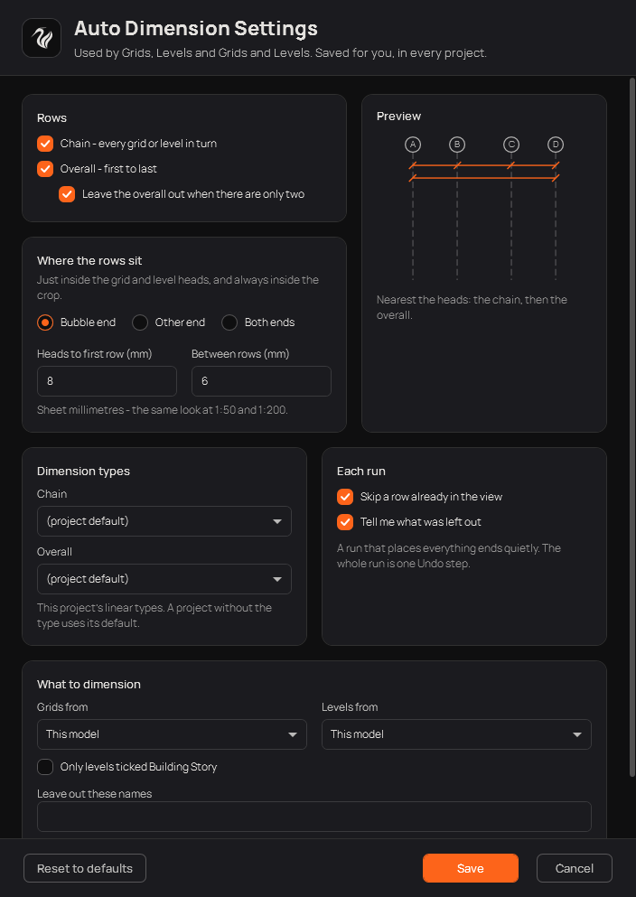

# Auto Dimension: moved from AJ-Tools (2026-11-22)

AJ-Tools' **Automatic Dimension** (grids / levels / both, and its settings window; `CmdAutoDimensions.cs`,
`Services/AutoDimension/AutoDimensionService.cs` v2.0.1, `Services/Dimensioning/*`, `AutoDatumDimensionSettingsWindow`)
was studied line by line and rebuilt in Heron Tools as **Auto Dimension** on the **Datums** panel. AJ-Tools was only
read; nothing there was changed.

Nothing here has run in a real Revit yet - the tool **needs a real Revit test** (steps at the end).

## Ribbon

Datums panel, large drop-down **Auto Dimension**: **Grids** · **Levels** · **Grids and Levels** · **Settings**.

## Kept from AJ-Tools (already right there)

Runs with or without a crop; rows on one end or both; chain and overall each with their own dimension type; the overall
left out when only two datums are in line (a note, never a "left out"); linked grids and levels through the link
reference rebuild (guarded, plain link reference as fallback); curved grids reported, not silently dropped; a refused
row does not stop the others; a dimension type saved in another project is kept in the list.

## Defects found and fixed

| Problem in AJ-Tools | Fix in Heron Tools |
|---|---|
| Rows were placed **outside the crop edge**. With an annotation crop they could be cut off; with no crop they ran over the grid bubbles. | Rows sit **just inside the grid and level heads** (owner's choice, 2026-11-22), measured from the heads as drawn in this view, and are kept inside the crop. |
| Grids at an angle to the screen (a wing at 30 degrees) were skipped. | Grids are grouped by direction; every parallel set gets its own rows, measured square to the grids. |
| Callouts cut from a section (view type Detail) were refused. | Allowed. Plan or section is decided by which way the view looks, so a plan-type callout is still a plan. |
| A row was skipped when **every** grid had **any** dimension - a wall-to-grid dimension on each grid stopped the grid row. | Only a dimension on exactly the same grids (or levels) counts as "already in the view". |
| "Leave out names" matched part of a name: `1` left out 1, 10, 11, 21... | Whole names, `;`-separated, with `*` and `?` wildcards. |
| Each row was its own transaction inside a group. | One named transaction per run (Heron rule); each row is a sub-step, so a refused row is taken back alone. `Commit()` is checked. |
| Each segment of a multi-segment grid was dimensioned as its own grid. | One stop per multi-segment grid per direction (its longest straight segment). |
| Linked grids came from **every** link in the model, also links hidden in the view. | Only links shown in the active view. |
| Linked grid in a section: where its plane crosses the section was used even when the grid stops short of it. | A linked grid counts only when its line really reaches the section line. |
| Linked grids in a view with no crop: every grid of the whole link was chained. | Limited to the span of this model's own datums; a note says to turn the crop on when there are none. |
| The selection was ignored. | Select grids or levels first and only those are dimensioned. |
| Area plans found by comparing the view type's name as text. | Checked directly. |
| Report pop-up after every partly-skipped run, from a TaskDialog. | The Heron message window, only when something was left out (switchable) or nothing could be placed; success is quiet. |

## Revit test the owner still owes

| # | Test | Expect |
|---|---|---|
| 1 | Floor plan, cropped, grids A-F and 1-8, bubbles at top and left: **Grids** | Chain just inside the top heads and inside the left heads, overall one gap further in; one Undo step |
| 1b | Grids with bubbles at the bottom and right only | Rows at the bottom and right (checks the bubble end is read right) |
| 2 | Same view, run **Grids** again | Nothing new; "already in the view" in the report |
| 3 | Settings: Both ends; run in a fresh plan | Rows at both ends of each set (both ends really placed) |
| 4 | Plan with a wing of grids at 30 degrees | The angled set gets its own rows, square to the grids |
| 5 | Section with levels and grids: **Grids and Levels** | Level rows inside the level heads, grid rows inside the grid heads |
| 6 | Callout of that section | Same as 5 |
| 7 | Plan with a multi-segment grid | One stop for it, no duplicate |
| 8 | Linked architectural model with grids, Grids from = Linked models | Rows to the linked grids; check they stay when the view is reopened |
| 9 | Annotation crop on, grids running past the crop | Rows inside the crop, all visible |
| 10 | Select three grids, then **Grids** | Only those three dimensioned |
| 11 | Settings: chain type set; open another project without that type | Default type used; report names the missing type |
| 12 | Each Revit year 2020, 2024, 2026, 2027 | Same results |
