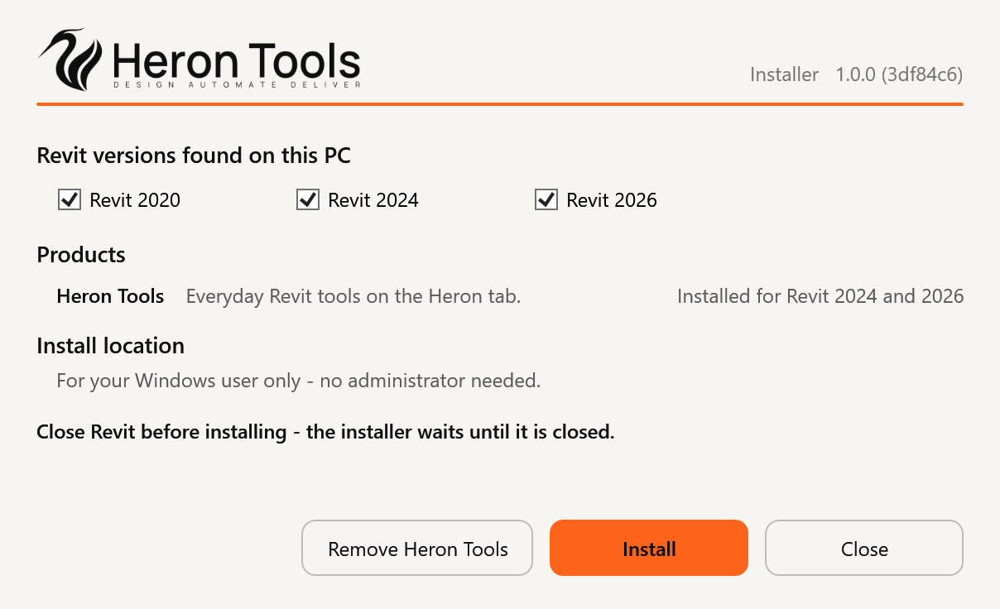

# Install Heron Tools

[README](../README.md) > Install

Heron Tools installs with one file, **`HeronToolsInstaller.exe`**. No administrator rights, nothing else to
install first.

## What you need

| | |
|---|---|
| Windows | Windows 10 or 11 (the installer runs on the .NET Framework 4.8 that Windows already has) |
| Revit | Any of **2020, 2021, 2022, 2023, 2024, 2025, 2026, 2027** - one or several |
| Rights | Your normal Windows user. Heron Tools is installed for **your Windows user only** |

Revit brings the .NET runtime it needs (.NET Framework 4.7.2 for 2020, 4.8 for 2021-2024, .NET 8 for 2025-2026, .NET 10 for
2027). Heron Tools needs nothing extra.

## Install in 4 steps

1. **Download** `HeronToolsInstaller.exe` from the newest release on the
   [Releases page](https://github.com/Ajmalpshaik/Heron-Tools/releases) (the top one, under **Assets**). A
   **Pre-release** badge means that version has not been tested in a real Revit yet. To check the download,
   compare `Get-FileHash .\HeronToolsInstaller.exe` in PowerShell with the release's `SHA256SUMS.txt`.
2. **Run it.** The installer is not code-signed yet, so Windows may show "Windows protected your PC". Click
   **More info**, then **Run anyway**.
3. **Tick your Revit versions.** The installer finds every Revit 2020 to 2027 on the PC, also Revit installed on
   another drive (such as `D:\Autodesk\Revit 2024`). Press **Install**.
4. **Start Revit.** Revit may ask about an unsigned add-in for Heron Tools - choose **Always Load**.

If one of the ticked Revit versions is open, the installer **waits** and says so, and carries on by itself once
that Revit is closed. It never closes Revit for you.

<p align="center">
  
</p>

## Check that it loaded

1. Open a project in Revit.
2. Look for the **Heron** tab on the ribbon with the panels **Quick, View, Datums, Modify, Coordination,
   About**. See the [tool catalogue](tools/README.md) for every button.
3. Click **About Heron** (Heron tab > About). It shows the Heron Tools version running in this Revit.

If Heron AI is also installed, its buttons share the same **Heron** tab. That is normal.

## First time in Revit

1. Every tool is on the **Heron** tab. Hover a button for a short tooltip; the
   [tool catalogue](tools/README.md) has the full steps for each one.
2. A greyed-out button needs another kind of view: **Quick Clash** and **Model Walk** need a **3D view**; the View
   Crop tools need plan views. Open the right view and the button turns on.
3. Set up the **Quick Menu** once: **Heron > Quick > Quick Menu Settings** picks what sits in each slot. Give the
   Quick Menu button a keyboard shortcut in Revit (**File > Options > User Interface > Keyboard Shortcuts**, search
   **Quick Menu**) to open the wheel at the mouse pointer.
4. Try a tool on a copy of a model first. Every run is **one Undo step** (Ctrl+Z).

There is nothing else to configure. Each window remembers its own choices.

## Where the files go

For each Revit year you ticked:

```
%AppData%\Autodesk\Revit\Addins\<year>\HeronTools.addin
%AppData%\Autodesk\Revit\Addins\<year>\HeronTools\        (HeronTools.dll and its files)
```

The install it replaces is kept in `%LocalAppData%\HeronTools\install-backup\<year>`. If a copy fails, the
installer puts the old one back by itself. Your own Heron Tools settings (Quick Menu slots, window choices, Model
Walk keys and settings) are in `%AppData%\HeronTools` and are not touched by install, update or remove.

## Update to a new version

Download the new `HeronToolsInstaller.exe` and press **Install** again. It replaces the old version - there is no
separate Update or Repair. Close Revit first, or let the installer wait for it.

## Remove Heron Tools

Run `HeronToolsInstaller.exe` and press **Remove Heron Tools**. It asks first (with **No** already picked), then
takes Heron Tools out of every Revit it is in. The button shows only while Heron Tools is installed.

It removes only `HeronTools.addin` and the `HeronTools` folder. Heron AI and every other add-in are left alone.

To remove it from one Revit version only, use the command line below with `/uninstall /years 2024`.

## For an office: install without a window

The same file runs from the command line (for example from a login script):

```powershell
HeronToolsInstaller.exe /install                     # every Revit found on this PC
HeronToolsInstaller.exe /install /years 2024,2026    # only these
HeronToolsInstaller.exe /uninstall                   # every Revit year
HeronToolsInstaller.exe /uninstall /years 2024       # one year
HeronToolsInstaller.exe /status                      # what is installed where
```

Add `/log <file>` to keep a record of what it did. Exit code **0** = done, **1** = something failed, **2** =
nothing to do (no Revit found).

## Common problems

| Problem | What to do |
|---|---|
| **No Heron tab in Revit** | Check that you ticked that Revit year, then restart Revit. When Revit asks about the unsigned add-in, choose **Always Load**. Run the installer again and look at its list: it shows where Heron Tools is installed. |
| **"No Revit was found on this PC"** | The installer looks for `Revit.exe` in `C:\Program Files\Autodesk\Revit <year>`, in Windows' list of installed programs, and for that year's Revit add-ins folder. If Revit is installed but not found, report it with the [Bug report](https://github.com/Ajmalpshaik/Heron-Tools/issues/new/choose) form. |
| **Windows blocks the installer** ("Windows protected your PC") | Click **More info**, then **Run anyway**. The installer is not code-signed yet. If your company blocks unsigned programs, ask IT to allow it. |
| **Revit says the add-in is a duplicate**, or loads Heron Tools twice | Another copy is in the all-users add-ins folder (`C:\ProgramData\Autodesk\Revit\Addins\<year>`, or `C:\Program Files\Autodesk\Revit\Addins\<year>` for Revit 2027). The installer reports it. Ask IT to remove that copy (it needs administrator rights). |
| **The installer keeps waiting** | A Revit of that year is still open (check the taskbar and Task Manager). Close it; the installer carries on by itself. |
| **Revit shows a .NET error when Heron Tools loads** | Revit brings its own .NET (.NET Framework 4.7.2 for 2020, 4.8 for 2021-2024, .NET 8 for 2025-2026, .NET 10 for 2027) and Heron Tools needs nothing more. Each Revit year needs its own build: run the installer again and press **Install** with that year ticked. If Revit itself reports a missing .NET, repair the Revit install. |
| **A button is greyed out** | That tool does not work in the open view (for example Quick Clash and Model Walk need a 3D view). See the [tool catalogue](tools/README.md). |
| **Revit shows "Heron Tools could not add its buttons"** | Restart Revit. If it happens again, run the installer again and press **Install**. |
| **Error details** | Most tools show the error in their own window or message - copy that text into the bug report. View Crop also writes an error log to `%AppData%\HeronTools\Logs`. Attach it (never a client model). |

## Build from source (advanced)

For developers and testers. You need the **.NET 10 SDK** (it builds every Revit target). Revit's own DLLs are not
needed. Close Revit, then from the repository folder in PowerShell:

```powershell
powershell -ExecutionPolicy Bypass -File build\build.ps1              # build every year, install into the Revits found
powershell -ExecutionPolicy Bypass -File build\build.ps1 -NoInstall   # build only
powershell -ExecutionPolicy Bypass -File build\build.ps1 -Years 2024  # one year
powershell -ExecutionPolicy Bypass -File build\build.ps1 -Years 2024 -Rollback   # put the previous install back
powershell -ExecutionPolicy Bypass -File build\build-installer.ps1    # make dist\HeronToolsInstaller-<version>.exe
powershell -ExecutionPolicy Bypass -File build\build-store-package.ps1   # make the Autodesk App Store zip (docs/store/package.md)
powershell -ExecutionPolicy Bypass -File build\uninstall.ps1          # remove (add -DryRun to see first)
```

The [README](../README.md#build-and-install-for-developers) explains every check the build script makes before it
copies anything.

## Help

- What each tool does: [tool catalogue](tools/README.md).
- A problem or an idea: [open an issue](https://github.com/Ajmalpshaik/Heron-Tools/issues/new/choose). Say which
  Revit version, what you did and what happened. Never attach a client model.
- A security problem: report it privately - see [SECURITY.md](../SECURITY.md).
