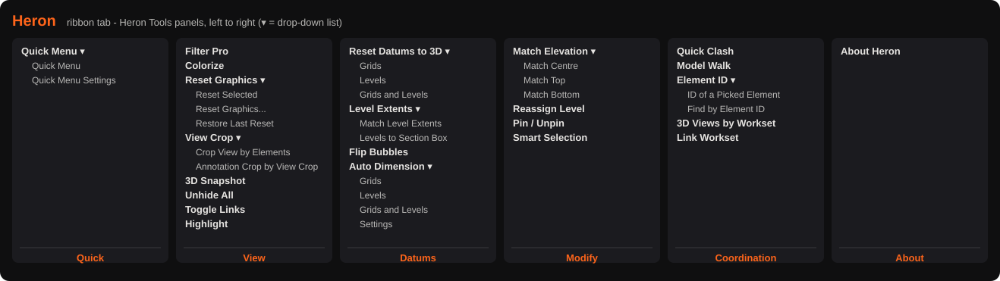

# Heron Tools - tool catalogue

Every button on the **Heron** ribbon tab that comes from Heron Tools: what it does, when to use it, how to use
it step by step, what it changes in the model and how to undo it.

> **Status:** every tool builds for Revit 2020 to 2027, but none has been signed off in a real Revit model yet
> (every source file is still `DRAFT`). Try a tool on a copy of a model first, and report anything odd with the
> [Bug report](https://github.com/Ajmalpshaik/Heron-Tools/issues/new/choose) form.

## Pages

| Panel | Tools | Page |
|---|---|---|
| Quick | Quick Menu, Quick Menu Settings | [quick.md](quick.md) |
| View | Filter Pro, Colorize, Reset Graphics, View Crop, 3D Snapshot, Unhide All, Toggle Links, Highlight | [view.md](view.md) |
| Datums | Reset Datums to 3D, Level Extents, Flip Bubbles | [datums.md](datums.md) |
| Modify | Match Elevation, Reassign Level, Pin / Unpin, Smart Selection | [modify.md](modify.md) |
| Coordination | Quick Clash, Model Walk, Element ID, 3D Views by Workset, Link Workset | [coordination.md](coordination.md) |
| About | About Heron | [about.md](about.md) |

Model Walk has its own full guide: [Model Walk user guide](../model-walk-guide.md).

## Which tool for which job

| I want to... | Use |
|---|---|
| Make view filters for every value of a parameter (e.g. one per system, one per size) | **Filter Pro** |
| Colour elements by value quickly, without making filters | **Colorize** |
| Show one or a few elements in red against a grey model | **Highlight** |
| Clear colour overrides from elements or a whole view (and get them back) | **Reset Graphics** |
| Bring back everything hidden in a view | **Unhide All** |
| Hide or show all Revit links in a view | **Toggle Links** |
| Fit plan crops around the model, and set the annotation crop with them | **View Crop** |
| See a room or a section in 3D in one click | **3D Snapshot** |
| Tidy grid and level ends in a view | **Reset Datums to 3D**, **Level Extents**, **Flip Bubbles** |
| Put MEP elements at the same height as another | **Match Elevation** |
| Move elements to another reference level without moving them | **Reassign Level** |
| Pin title blocks, views on sheets, grids, ducts... in one go | **Pin / Unpin** |
| Window-select only one category | **Smart Selection** |
| Find clashes in a 3D view without leaving Revit | **Quick Clash** |
| Walk through the model, measure and record snags | **Model Walk** |
| Find an element by its ID, also in a link | **Element ID** |
| Check each workset on its own | **3D Views by Workset** |
| Put links and CAD imports on the right workset | **Link Workset** |
| Have my favourite buttons at the mouse pointer | **Quick Menu** |

## Rules every tool follows

- **One button press = one Undo step.** If anything fails, the whole run is undone and the tool says so in
  plain words. Press **Ctrl+Z** (or Revit's Undo) to undo a run.
- **Your own graphic overrides are never lost without a way back.** Colorize has **Restore original**,
  Highlight puts the view back on the second click, Reset Graphics has **Restore Last Reset**, Quick Clash has
  **Reset view**, and Model Walk gives snag colours back with **J** (and before Save / Sync with Central).
- **A greyed-out button** means it does not work in the view that is open (for example Quick Clash needs a 3D
  view). The tooltip and the page for that tool say which views it needs.
- **Results show in the tool's window** (a status line and a list of anything skipped, with the reason). A
  pop-up appears only for a real problem you must act on.
- **Distances are in millimetres** in every window.

## Revit versions

The same tools are built for **Revit 2020, 2021, 2022, 2023, 2024, 2025, 2026 and 2027**. Where a tool does a
little less in older Revit versions, its page says so in **Limits**.

## Help

- Install, update and remove: see the [install guide](../install.md).
- A problem or an idea: [open an issue](https://github.com/Ajmalpshaik/Heron-Tools/issues/new/choose). Say which
  tool, which Revit version, which view, what you did and what happened. Never attach a client model.
