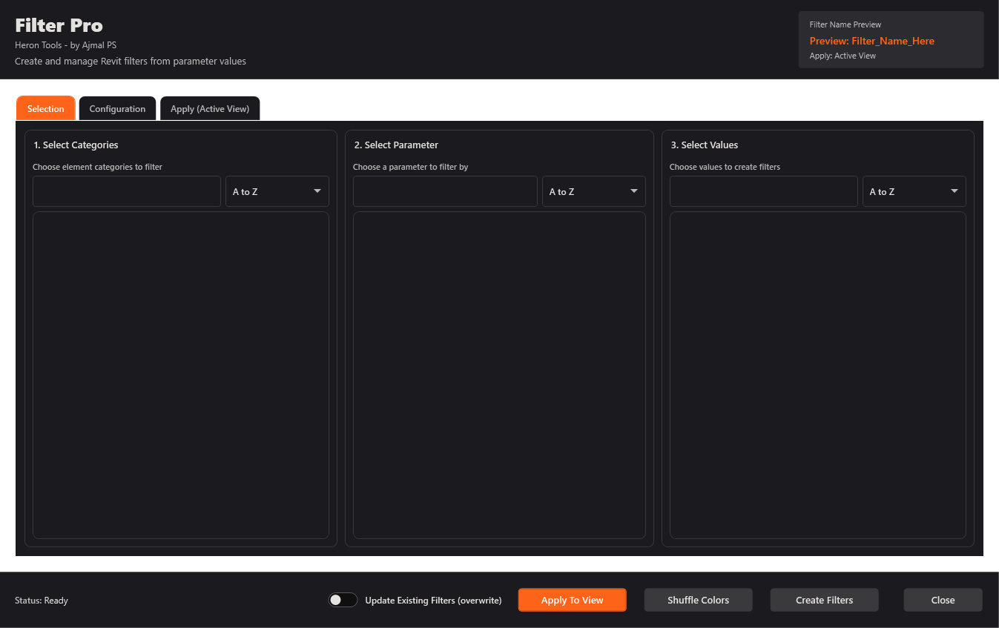

# View panel

[Tool catalogue](README.md) > View

Tools for what a view shows and how it looks: view filters, colours, crops, hidden elements and links.

| Button | Works in |
|---|---|
| Filter Pro, Colorize | Floor, ceiling, structural and area plans, sections, detail views, elevations and 3D views that take graphic overrides (not view templates) |
| Reset Graphics (all three), Unhide All, Highlight | Any view that takes graphic overrides (not view templates) |
| View Crop (both) | Floor, ceiling, structural and area plans |
| 3D Section Box | Floor, ceiling, structural and area plans, sections, elevations and detail views |
| Toggle Links | Any view where the RVT Links category can be hidden |

A button is greyed out in any other view.

---

## Filter Pro

**What it does:** makes one view filter per parameter value, names each filter for you and adds them to the
active view (or to views you pick), at the top of the filter list.

**When to use it:** to colour a model by system, size, level, workset or any parameter, with real view filters
that stay in the view and can go into a view template.

**How to use it:**

1. Open a plan, section, elevation or 3D view. Click **Filter Pro** (Heron tab > View).
2. The window reads left to right: **1 Categories** - tick one or more categories.
3. **2 Parameter** - pick the parameter to filter by.
4. **3 Values** - tick the values you want. Each column has a search box and a count ("2 of 10 picked").
5. On the right, check the live **name preview**, then use the tabs: **Rule** (Equals, Not equals, Has value...;
   rules that do not suit the parameter are switched off), **Name**, **Apply** (active view or picked views) and
   **Colours** (**Shuffle colours** gives every filter its own colour).
6. Click **Apply to view** (the orange button).

**What it changes in the model:** new view filters (Manage > Filters) and their overrides in the views you
picked. Filters that already exist in a view keep their place and their overrides.

**Undo:** each run is one Undo step - press **Ctrl+Z**. Later, remove a filter in the view's
**Visibility/Graphics > Filters** tab, or delete it in **Manage > Filters**.

**Limits:**

- A rule Revit cannot use for the picked categories is refused and listed; nothing half-made is left.
- A text rule (Contains...) on a number parameter is refused with a message.
- "Family and Type" offers only the Equals rule.
- Revit 2020: the filter order in a view is remembered by Heron Tools (Revit 2021 and later reads it from the
  view itself).

---

## Colorize

**What it does:** the same picks as Filter Pro (categories, a parameter, values), but the colour goes straight
onto the matching elements as graphic overrides - no view filter is made. Or colour whole categories, one colour
each.

**When to use it:** a quick colour check in one view, when you do not want to add filters to the model.

**How to use it:**

1. Open a plan, section, elevation or 3D view. Click **Colorize**.
2. Pick categories, a parameter and values (or choose whole categories).
3. **Shuffle colours** gives every value its own colour; click it again for a new set.
4. Apply to the active view or to views you pick.

**What it changes in the model:** element graphic overrides in the chosen views (insulation and lining too).
The colour replaces the elements' own overrides.

**Undo:** **Restore original** puts back each element's own overrides (one Undo step). **Ctrl+Z** also undoes a
run.

**Limits:**

- Colorize remembers the original overrides only while Revit stays open. After a restart, select the elements,
  right-click **Override Graphics in View > By Element** and press **Reset**, or use **Reset Graphics**.
- Only drafting fill patterns are offered (Revit refuses model patterns as overrides).

Screenshot needed: the Colorize window with values picked.

---

## Reset Graphics

A drop-down with three buttons.

### Reset Selected

**What it does:** clears the graphic overrides of the selected elements in the active view - one click, no
window. Their insulation and lining are reset with them.

**How to use it:** select elements, then **Reset Graphics > Reset Selected** (or click it first and pick the
elements, then **Finish**).

### Reset Graphics...

**What it does:** clears element overrides, category (Visibility/Graphics) overrides, or both - in this view or
in views you pick.

**How to use it:**

1. **Reset Graphics > Reset Graphics...**
2. Choose what to clear and which views. The window counts what it found before you press **Reset**.
3. To keep Colorize and Highlight colours, choose the option that leaves them alone.

**Limits:** views whose view template controls Visibility/Graphics keep their category overrides.

### Restore Last Reset

**What it does:** puts back every override the last reset in this model cleared. It works while Revit stays
open, even after other work (where Undo would also undo that work).

**What these change in the model:** element and/or category graphic overrides in the views you chose.

**Undo:** **Restore Last Reset**, or **Ctrl+Z**. Each button press is one Undo step.

Screenshot needed: the Reset Graphics window showing the counts.

---

## View Crop

A drop-down with two buttons. Both work in floor, ceiling, structural and area plans.

### Crop View by Elements

**What it does:** fits the crop region of the picked plan views around their elements, with a margin (300 mm
as standard).

**How to use it:**

1. **View Crop > Crop View by Elements.**
2. Pick the views.
3. Choose whether the crop fits the **visible elements** or **all model elements**, and set the offset. Tick
   **Levels, grids and reference planes** if they should push the crop out too.
4. Run.

**Limits:**

- Views with a non-rectangular (shaped) crop are skipped and listed - their shape is not lost.
- Survey Point, Project Base Point and Internal Origin are never counted.
- Revit 2024 and later measures only the linked elements each view shows. Revit 2020-2023 cannot ask that, so a
  visible link is measured whole.

### Annotation Crop by View Crop

**What it does:** turns on the annotation crop in the picked views and sets an equal offset from each view's
crop region. The offset is measured **on paper** (25 mm as standard, never below 3.2 mm), as Revit does.

**How to use it:** **View Crop > Annotation Crop by View Crop**, pick the views and the offset, run.

**Limits:** a view with **Crop View** off is skipped with "turn on Crop View first".

**What these change in the model:** the crop region and annotation crop of the picked views.

**Undo:** each run is one Undo step - **Ctrl+Z**.

---

## 3D Section Box

**What it does:** one click fits Revit's own 3D view ({3D}) to what you are working on. You stay in your view;
the 3D view updates behind it (it opens behind if it is closed).

**How to use it - pick one:**

- **A room, space or zone:** select it (or its tag - rooms in links too) and click **3D Section Box**. The section
  box fits it, from its level to its upper limit.
- **A section:** select a section mark, or run it while you are in a section, elevation or detail view. The box
  matches the section (same cut, same depth) and the camera looks the same way.
- **A plan area:** with nothing selected in a plan, click **3D Section Box** and drag a window. The box runs from the
  bottom to the top of the view range.

**What it changes in the model:** the section box and camera of the 3D view Revit's own 3D button opens
({3D - your user name} in a workshared model, {3D} otherwise), with 300 mm extra on every side.

**Undo:** one Undo step - **Ctrl+Z**.

**Limits:** select just one section mark at a time.

---

## Unhide All

**What it does:** shows everything hidden in the active view - turns Temporary Hide/Isolate off and unhides
elements hidden one by one in the view.

**How to use it:** open the view, click **Unhide All**.

**What it changes in the model:** the "hidden in view" state of elements in this view.

**Undo:** one Undo step - **Ctrl+Z**.

**Limits:** categories and filters hidden in **Visibility/Graphics** are left as they are (the report says so).

---

## Toggle Links

**What it does:** turns the **RVT Links** category off or on in the active view - the same as ticking RVT Links
in Visibility/Graphics. One click hides all links, the next shows them again.

**How to use it:** open the view, click **Toggle Links**.

**What it changes in the model:** the RVT Links category visibility of this view.

**Undo:** click again, or **Ctrl+Z** (one Undo step).

**Limits:** links hidden one by one stay hidden; the tool says how many and how to show them.

---

## Highlight

**What it does:** shows the selected elements in red and everything else in grey in the active view.

**How to use it:**

1. Select elements (or click **Highlight** first and pick them, then **Finish**).
2. Click **Highlight**.
3. Click **Highlight** again in the same view to put the view back.

**What it changes in the model:** element graphic overrides in this view. Every element's own overrides are
remembered.

**Undo:** click **Highlight** again in the same view, or **Ctrl+Z**. If the highlight was already undone, the next
click highlights again instead.

**Limits:** the memory lasts while Revit stays open. After a restart, select the elements, right-click
**Override Graphics in View > By Element** and press **Reset**, or use **Reset Graphics**.

---

## Revit versions

All View tools: 2020 to 2027. Differences are listed under **Limits** above.
